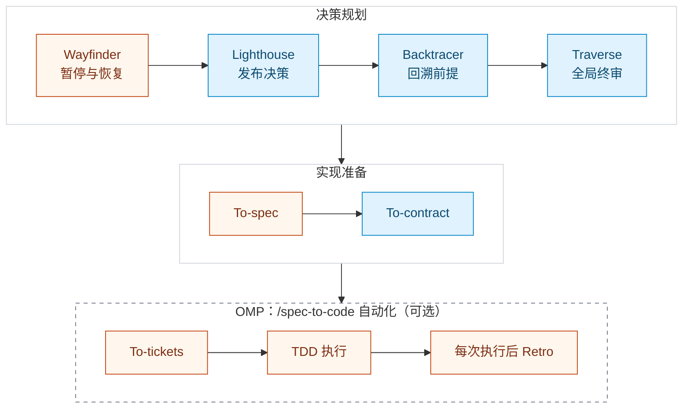

# Oh My Wayfinder

[English](./README.md)

**让决策跨会话保持完整，让需求在实现前变得可验证，让每次执行留下经验。**

Oh My Wayfinder 是 [mattpocock/skills](https://github.com/mattpocock/skills) 的非侵入式 fork，面向需要多个会话才能推进的大型 AI 辅助开发工作，并为 [Oh My Pi](https://github.com/can1357/oh-my-pi)（OMP）提供可选的自动化扩展。

## 为什么需要这个 fork？

### 会话结束了，决策不一定已经完成

大型工作需要研究、原型，以及彼此依赖的设计讨论。一个问题尚未讨论完，不应阻止其中已确认的结果发挥作用；新会话也不应从头重建整段讨论。

本仓库为 Wayfinder 增加暂停与恢复，把已确认决策发布为可共同引用的权威来源，并回溯其前提，检查缺口与冲突；在形成规格前，再对整体设计做一次终审。目标是让工作可以连续推进，而不是把其他票的政策复制进每一张票。

### 如果需求已经丢失，测试通过也不够

需求可能在切票时遗漏，测试也可能变成对当前实现的确认，而不是对原本承诺的验证。

本仓库把规格与已批准的契约分开，明确承诺及测试 seam，将交付与覆盖责任分配给实现票，并围绕这些责任强化 TDD。目标是从已批准的要求追溯到能够发现违约行为的证据，而不只是得到一套绿色测试。

### 实现结束，不应丢掉这次工作带来的经验

上游已经提供 Retro。本仓库的 OMP 扩展将它接入自动化执行：每次 TDD 执行都有独立复盘，实现与复盘结果分别报告。改进建议会被记录，而不会自动执行；执行结束本身也不代表验收已经通过。

## 流程概览

本仓库分为两部分：适用于支持 Markdown skill 的 agent 的**通用技能**，以及用于连续、无人托管执行的 **OMP 专用扩展**。其他 agent 用户仍可手动调用 skills 完成通用规划与实现流程，不需要安装 OMP 扩展。

下面展示大型工作的主路径，不包含上游全部分支或具体执行规则。

### 上游流程


### 本仓库流程



**蓝色**表示新增 skill，**橙色**表示职责或集成方式发生变化。Lighthouse 与 Backtracer 在决策发布边界参与工作，Traverse 在地图完成后做终审；图中省略反复讨论、暂停恢复和缺口跟进分支。虚线框表示 OMP 自动化覆盖的部分，不代表这些环节必须使用 OMP。

Skill 内的自动调用由 agent 执行指令，不是独立调度器；`/spec-to-code` 另外提供宿主驱动的编排。它以已有 spec 和已批准 contract 为输入，自动切票、串行执行 TDD，并自动调用 Retro。

需要并行开发时，使用独立命令 [`/hyper-auto-coding`](docs/hyper-auto-coding.cn.md)：用户先创建本地集成分支并提交输入文档；切票后自动提交票据，每票在独立 worktree 中实现，首次合入即放行下游，复用开发 worktree 异步测试和修复，冲突续跑同一个集成子代理。仅短暂双向 merge 操作串行；最终独立整体验证、必要修复后提交报告，不再有 code-review 门禁。默认实现并发数为 4，可与 Jev 在同一配置文件调整；旧命令保持串行。

设计变化及其对应的 mapping op，见[上游对比蓝图](docs/upstream-differences.cn.md)。

## 快速开始

通用 skills 不需要修改 agent 本体或使用专用安装器：先安装上游，再复制覆盖。

1. 安装 Matt 的技能集：`npx skills@latest add mattpocock/skills`。
2. 将本仓库 `skills/` 中的内容复制到 agent 已安装的 skill 目录，保留各 skill 的目录结构；覆盖同名文件，并加入新增目录。
3. 在实际使用的项目中运行 `/setup-matt-pocock-skills`。如果项目此前已使用 Matt 的 skills，请重新运行 setup，检查并确认更新项目中的持久化配置。替换已安装的 skills 不会自动更新项目配置，也不会自动迁移既有票据。
4. 不知道下一步做什么？调用 `/ask-matt`，根据当前场景选择 skill。

**适用范围：** Wayfinder 的扩展暂停／发布／回溯循环目前针对本地 Markdown tracker，尚未接入 GitHub／GitLab tracker 配置。

**OMP 用户：** 按 [spec-to-code 使用指南](docs/spec-to-code.cn.md)安装并运行可选扩展。仅复制 skills 不会安装 `/spec-to-code`。

## 进一步阅读

| 我想…… | 阅读入口 |
|---|---|
| 选择下一步调用的 skill | [Ask Matt](skills/ask-matt/SKILL.md) |
| 理解本仓库改了什么、改动在哪里 | [上游对比蓝图](docs/upstream-differences.cn.md) |
| 安装、配置和使用串行 OMP 自动化 | [Spec-to-code 使用指南](docs/spec-to-code.cn.md) |
| 在本地集成分支上并行开发 | [Hyper-auto-coding 使用指南](docs/hyper-auto-coding.cn.md) |
| 修改 mapping、构建技能或同步上游 | [维护指南](docs/maintenance.cn.md) |

## 维护命令

```bash
node deltas/build.mjs                         # 生成 skills 并刷新 preview
node deltas/build.mjs --check                 # 只检查生成一致性，不写文件
node deltas/preview.mjs                       # 仅刷新 preview
node deltas/check-upstream.mjs                # 比较快照与上游 HEAD
node deltas/check-upstream.mjs --verbose      # 同时列出具体差异文件
node deltas/check-upstream.mjs --local <dir>  # 与本地上游 checkout 比较
```

修改生成技能时应编辑 mapping，而不是生成文件。源码归属、mapping 语法和上游同步步骤见[维护指南](docs/maintenance.cn.md)。

## 致谢

本项目建立在 [mattpocock/skills](https://github.com/mattpocock/skills) 之上。感谢 Matt Pocock 提供工程工作流并以 MIT 协议开源技能，感谢 [skills.sh](https://skills.sh/mattpocock/skills) 与 [AI Hero 新闻通讯](https://www.aihero.dev/s/skills-newsletter)，以及为可选自动化扩展提供平台的 [Oh My Pi](https://github.com/can1357/oh-my-pi)。

## License

MIT，见 [LICENSE](./LICENSE)。上游版权声明原样保留：*Copyright (c) 2026 Matt Pocock*。
