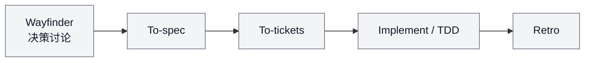
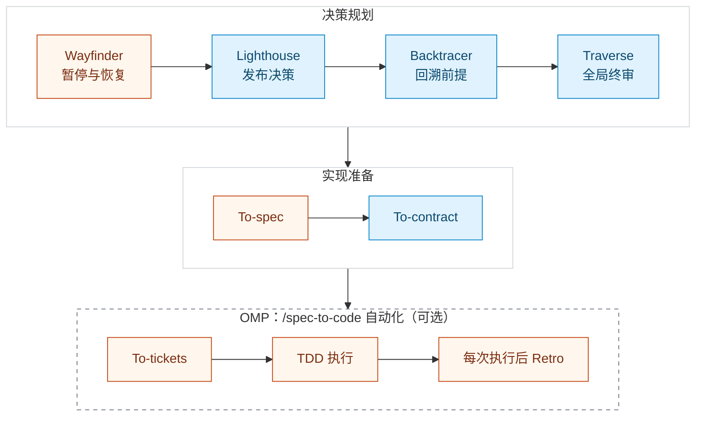

# Oh My Wayfinder

[English](./README.md)

你有没有遇到过这些情况？

- **每个问题都和 AI 讨论清楚了，拼起来却不是那么回事。** 一个大需求拆成多张 ticket 后，每张票单独看都合理，但之前的约束被遗漏，不同讨论中的决定互相冲突，直到实现时才暴露。
- **一个问题聊了很久还没结束，你却已经想先处理另一个问题。** 继续聊，可能是在尚未确定的前提上反复纠结；换个会话，又担心丢掉已经讨论出的结论，以及那些同样重要的理由。
- **AI 准备开始写代码了，你仍然说不清自己会得到什么。** 方案听起来没问题，但代码对外提供什么、架构是否方便测试、最后怎么验收，还没有形成具体认识。

Oh My Wayfinder 是我在使用 [Matt Pocock 的 Wayfinder](https://github.com/mattpocock/skills) 时，为解决这些问题做的一组改进。

Wayfinder 本身已经是一个很棒的 skill，帮助我们探索复杂问题，并把未知拆成可以逐步解决的决策。这个 fork 建立在它的基础上，把我在实际开发中的一些思考和工作习惯带进了流程，重点改进下面三件事。

## 为什么需要这个 fork？

### 1. 拆开问题，不该拆散对整个系统的理解

我很喜欢用 Wayfinder 把巨大的问题拆成一张张 ticket。但用得越多，我越感到一个问题：**ticket 之间的联系，会随着讨论被拆开而变弱。**

一次连贯的 grilling 中，前面为什么这样决定、这个选择影响了什么，都还在同一个上下文里。拆成多张 ticket 后，每次讨论可能都很充分，却不一定共享同一套认识。在我的一些实践中，最终实现的代码质量甚至不如一次完整的 grilling。

我希望把这些讨论重新联系起来。为此，我加入了 **Lighthouse** 和 **Backtracer**。

Matt 把 Wayfinder 探索的未知称为 **Fog of War**。我借用了这个意象，为后续讨论提供决策参照的 skill 命名：**Lighthouse**。它保存已经确认的结论、理由与适用条件，让其他 ticket 有一个共同的依据，而不是各自记住一份略有不同的答案。

**Backtracer 则负责带着新的认识，回头检查旧的决定。**

这和我平时思考的习惯一样：刚刚确定的方案，会不会推翻之前的某个前提？两个看起来合理的选择，放在一起有没有矛盾？是不是漏掉了一个必须先回答的问题？

在票据完成或暂停等决策发布边界，Backtracer 会回溯相关决定，找出需要用户判断和修正的地方。这样，解决一张 ticket 不只是向前走一步，也是在重新检查整个方案是否仍然站得住。

### 2. 当前问题不好决定？先保存成果，换一个问题

有些 grilling 很难在一次对话中结束。问题太大是一种原因，另一种原因是：**你正在讨论的选择，取决于另一个尚未确定的选择。**

这时，最有效的下一步未必是继续回答当前问题。

这个 fork 允许你在 ticket 尚未完成时暂停：保存已经确认的决定、背后的理由、重要上下文与未决问题，把冗长的探索过程压缩成足以继续讨论的成果。临时假设和无效尝试不必全部带进下次会话；仍会影响后续判断的拒绝理由与关键证据则保留下来。

你可以放心离开当前问题，先去处理更重要、或更有助于其他决策的 ticket。

例如，A 的五种方案都取决于 B。与其把五条路分别讨论到底，不如先暂停 A，确定 B，再回来。届时，可能只剩一条路值得继续。

**暂停因此不只是“下次接着聊”，也是调整思考顺序的一种工具。**

暂停时，已确认的结果可以通过 Lighthouse 发布，并由 Backtracer 回溯相关前提。即使一张 ticket 尚未结束，它产生的认识也能帮助其他讨论；等你回来时，再结合相关的新结论继续，而不是重走一遍旧路。

### 3. 别等代码写完，才发现它不是你想要的样子

“方案已经讨论清楚”和“我知道 AI 接下来会写出什么”，并不是一回事。

你可能认可功能设计，却还不知道它会暴露怎样的接口；也可能直到验收时，才发现关键行为很难测试，需要先改造代码结构。

受[双环 TDD](https://growing-object-oriented-software.com/) 的启发，我从 `/to-spec` 中拆出了 **`/to-contract`**，把三个问题放到实现之前，通过三轮简短问答对齐：

1. **它向外提供什么？** 明确代码的行为、接口与边界。
2. **什么样的结构才容易测试？** 先选择测试 seam，确定能够观察关键行为、控制相关依赖的架构边界，而不是写完后再设法塞进测试。
3. **怎样才算验收通过？** 明确验收场景、通过标准，以及需要提供的证据。

这不是让你提前审阅每个实现细节，而是让你在 AI 开始写代码前，先看清这次交付的轮廓。

这个过程也常常会暴露前面讨论中遗漏的细节：某个承诺其实还不明确，某个边界不方便验证，或者你和 AI 对“完成”的理解并不相同。

**`/to-contract` 不是多写一份文档，而是让这些分歧在代码诞生之前出现。**

## 流程概览

本仓库分为两部分：适用于支持 Markdown skill 的 agent 的**通用技能**，以及用于连续、无人托管执行的 **OMP 专用扩展**。其他 agent 用户仍可手动调用 skills 完成通用规划与实现流程，不需要安装 OMP 扩展。

下面展示大型工作的主路径，不包含上游全部分支或具体执行规则。

### 上游流程



### 本仓库流程



**蓝色**表示新增 skill，**橙色**表示职责或集成方式发生变化。Lighthouse 与 Backtracer 在决策发布边界参与工作，Traverse 在地图完成后做终审；图中省略反复讨论、暂停恢复和缺口跟进分支。虚线框表示 OMP 自动化覆盖的部分，不代表这些环节必须使用 OMP。

Skill 内的自动调用由 agent 执行指令，不是独立调度器；`/spec-to-code` 另外提供宿主驱动的编排。它以已有 spec 和已批准 contract 为输入，自动切票、串行执行 TDD，并自动调用 Retro。

需要并行开发时，使用独立命令 [`/hyper-auto-coding`](docs/hyper-auto-coding.cn.md)：用户先创建本地集成分支并提交输入文档；切票后自动提交票据，每票在独立 worktree 中实现，首次合入即放行下游，复用开发 worktree 异步测试和修复，冲突续跑同一个集成子代理。仅短暂双向 merge 操作串行；最终独立整体验证、必要修复后提交报告，不再有 code-review 门禁。默认实现并发数为 4，可与 Jev 在同一配置文件调整；旧命令保持串行。

设计变化及其对应的 mapping op，见[上游对比蓝图](docs/upstream-differences.cn.md)。

## 快速开始

通用 skills 不需要修改 agent 本体或使用专用安装器：先安装上游，再复制覆盖。

1. 安装 Matt 的技能集：`npx skills@latest add mattpocock/skills`。
2. 将本仓库 `skills/` 中的内容复制到 agent 已安装的 skill 目录，保留各 skill 的目录结构；覆盖同名文件，并加入新增目录。
3. 在实际使用的项目中运行 `/setup-matt-pocock-skills`。如果项目此前已使用 Matt 的 skills，请重新运行 setup，检查并确认更新项目中的持久化配置。替换已安装的 skills 不会自动更新项目配置，也不会自动迁移既有票据。
4. 不知道下一步做什么？调用 `/ask-matt`，根据当前场景选择 skill。

**适用范围：** Wayfinder 的扩展暂停／发布／回溯循环目前针对本地 Markdown tracker，尚未接入 GitHub／GitLab tracker 配置。

**OMP 用户：** 按 [spec-to-code 使用指南](docs/spec-to-code.cn.md)安装并运行可选扩展。仅复制 skills 不会安装 `/spec-to-code`。

## 进一步阅读

| 我想…… | 阅读入口 |
|---|---|
| 选择下一步调用的 skill | [Ask Matt](skills/ask-matt/SKILL.md) |
| 理解本仓库改了什么、改动在哪里 | [上游对比蓝图](docs/upstream-differences.cn.md) |
| 安装、配置和使用串行 OMP 自动化 | [Spec-to-code 使用指南](docs/spec-to-code.cn.md) |
| 在本地集成分支上并行开发 | [Hyper-auto-coding 使用指南](docs/hyper-auto-coding.cn.md) |
| 修改 mapping、构建技能或同步上游 | [维护指南](docs/maintenance.cn.md) |

## 维护命令

```bash
node deltas/build.mjs                         # 生成 skills 并刷新 preview
node deltas/build.mjs --check                 # 只检查生成一致性，不写文件
node deltas/preview.mjs                       # 仅刷新 preview
node deltas/check-upstream.mjs                # 比较快照与上游 HEAD
node deltas/check-upstream.mjs --verbose      # 同时列出具体差异文件
node deltas/check-upstream.mjs --local <dir>  # 与本地上游 checkout 比较
```

修改生成技能时应编辑 mapping，而不是生成文件。源码归属、mapping 语法和上游同步步骤见[维护指南](docs/maintenance.cn.md)。

## 致谢

本项目建立在 [mattpocock/skills](https://github.com/mattpocock/skills) 之上。感谢 Matt Pocock 提供工程工作流并以 MIT 协议开源技能，感谢 [skills.sh](https://skills.sh/mattpocock/skills) 与 [AI Hero 新闻通讯](https://www.aihero.dev/s/skills-newsletter)，以及为可选自动化扩展提供平台的 [Oh My Pi](https://github.com/can1357/oh-my-pi)。

## License

MIT，见 [LICENSE](./LICENSE)。上游版权声明原样保留：*Copyright (c) 2026 Matt Pocock*。
