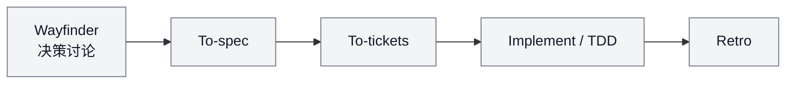
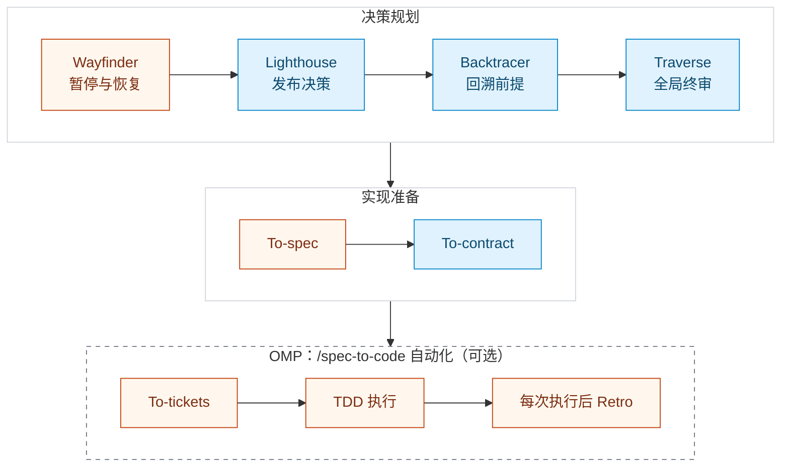

# Oh My Wayfinder

[English](./README.md)

当你觉得用 grill-me 已经能构建任何程序，摩拳擦掌地准备用 Wayfinder 挑战更大的问题时，是否也遇到过这些情况？

- **每个问题都和 AI 讨论清楚了，拼起来却不是那么回事。** 一个大需求拆成多张 ticket 后，每张票单独看都合理，但之前的约束被遗漏，不同讨论中的决定互相冲突，直到实现时才暴露。
- **一张 ticket 还没讨论完，对话却已进入“dumb zone”。** 议题太大，讨论迟迟看不到尽头，又没有办法停下来。
- **AI 准备开始写代码了，你仍然说不清自己会得到什么。** 方案听起来没问题，但代码对外提供什么、架构是否方便测试、最后怎么验收，还没有形成具体认识。

Oh My Wayfinder 是我在使用 [Matt Pocock 的 Wayfinder](https://github.com/mattpocock/skills) 时，为解决这些问题做的一组改进。

Wayfinder 本身已经是一个很棒的 skill，帮助我们探索复杂问题，并把未知拆成可以逐步解决的决策。这个 fork 建立在它的基础上，把我在实际开发中的一些思考和工作习惯带进了流程，重点改进下面三件事。

## 为什么需要这个 fork？

### Lighthouse：让拆开的决策重新联系起来

Matt Pocock 将 Wayfinder 探索的未知称为 Fog of War。我沿用这一比喻，将保存已确认决策、为后续探索提供参照的 skill 命名为 Lighthouse。

在使用 Wayfinder 处理大型任务的过程中，我发现：将一个复杂问题拆分为多张 ticket，虽然降低了单个问题的处理难度，却也削弱了各项决策之间的联系。在部分实践中，基于多张 ticket 的讨论结果完成的实现，质量反而不如一次连贯的 grilling。

问题不一定在于单张 ticket 的讨论不够深入，而在于：局部合理的决定，组合起来未必能形成一致的整体。

为此，我加入了 Lighthouse 和 Backtracer：

- Lighthouse 保存已确认的结论、理由与适用条件，为不同 ticket 提供共同的决策依据，避免各自维护一份逐渐产生分歧的理解。
- Backtracer 根据新结论回溯已有决定，检查其前提，识别遗漏与矛盾，再交由用户判断是否需要补充或修正。

这一机制源于我的日常思考习惯：每解决一个问题，都回头检查先前的判断是否仍然成立。在票据完成、暂停等决策发布边界，回溯过程会将新结论带回已有讨论，检验它们之间的一致性，让分散的决策逐步形成连贯的整体。

### 暂停 Grilling：保留思考成果，也允许换一条路继续

有些议题过于庞大，无法在一次对话中完成全部决策。持续推进同一议题，可能使讨论不断延长，却难以收敛。

这个 fork 允许在 ticket 尚未完成时暂停 grilling，将已有讨论压缩为足以继续推进的成果。保存的内容不仅包括已确认的决定，还包括背后的理由、重要上下文与未决问题。临时假设、无效探索和冗长的研究过程不必完整带入下一次会话；仍会影响后续判断的拒绝理由与关键证据则予以保留。

暂停不仅支持后续恢复，也让决策顺序可以灵活调整。

如果当前问题的多个选项取决于另一项尚未确定的决策，就可以先保存进展，优先解决前置问题，再返回原来的讨论。前置决策的明确，往往能够缩小候选范围，降低后续判断的难度。

暂停时，已确认的结果可以通过 Lighthouse 发布，并由 Backtracer 回溯相关前提。这样，即使一张 ticket 尚未完成，其中的有效结论也能支持其他讨论；恢复时，再结合相关的新结论确定下一步，而不必从头开始。

### To-contract：在 AI 写代码之前，先看清你将得到什么

设计讨论结束，并不意味着我们已经对即将生成的代码形成清晰认识：它对外承诺什么？怎样组织才便于测试？最终应如何验收？

受[双环 TDD](https://growing-object-oriented-software.com/) 的启发，我从 `/to-spec` 中拆出了 `/to-contract`，通过实现前的三轮简短问答，对齐三个问题：

1. **它向外提供什么？** 明确行为、接口与边界，界定本次交付的对外契约。
2. **它应该怎样组织，才容易测试？** 从选择测试 seam 入手，确定便于观察关键行为、控制相关依赖的架构边界，避免在实现完成后才为测试改造代码。
3. **我怎样验收它？** 明确验收场景、通过标准，以及证明承诺得到兑现所需的证据。

这三个问题共同划定实现的边界与精度，也有助于发现前期决策中遗漏的细节。

`/to-contract` 的目的不是换一种格式重写规格，而是帮助人在实现开始前，对即将生成的代码形成整体认识：明确它将提供什么、哪些关键结构使其易于测试，以及达到什么标准才算符合预期。

## 流程概览

本仓库分为两部分：适用于支持 Markdown skill 的 agent 的**通用技能**，以及用于连续、无人托管执行的 **OMP 专用扩展**。其他 agent 用户仍可手动调用 skills 完成通用规划与实现流程，不需要安装 OMP 扩展。

下面展示大型工作的主路径，不包含上游全部分支或具体执行规则。

### 上游流程



### 本仓库流程



**蓝色**表示新增 skill，**橙色**表示职责或集成方式发生变化。Lighthouse 与 Backtracer 在决策发布边界参与工作，Traverse 在地图完成后做终审；图中省略反复讨论、暂停恢复和缺口跟进分支。虚线框表示 OMP 自动化覆盖的部分，不代表这些环节必须使用 OMP。

Skill 内的自动调用由 agent 执行指令，不是独立调度器；`/spec-to-code` 另外提供宿主驱动的编排。它以已有 spec 和已批准 contract 为输入，自动切票、串行执行 TDD，并自动调用 Retro。

需要并行开发时，使用独立命令 [`/hyper-auto-coding`](docs/hyper-auto-coding.cn.md)：用户先创建本地集成分支并提交输入文档；切票后自动提交票据，每票在独立 worktree 中实现，首次合入即放行下游，复用开发 worktree 异步测试和修复，冲突续跑同一个集成子代理。仅短暂双向 merge 操作串行；最终独立整体验证、必要修复后提交报告，不再有 code-review 门禁。默认实现并发数为 4，可与 Jev 在同一配置文件调整；旧命令保持串行。

设计变化及其对应的 mapping op，见[上游对比蓝图](docs/upstream-differences.cn.md)。

## 快速开始

通用 skills 不需要修改 agent 本体或使用专用安装器：先安装上游，再复制覆盖。

1. 安装 Matt 的技能集：`npx skills@latest add mattpocock/skills`。
2. 将本仓库 `skills/` 中的内容复制到 agent 已安装的 skill 目录，保留各 skill 的目录结构；覆盖同名文件，并加入新增目录。
3. 在实际使用的项目中运行 `/setup-matt-pocock-skills`。如果项目此前已使用 Matt 的 skills，请重新运行 setup，检查并确认更新项目中的持久化配置。替换已安装的 skills 不会自动更新项目配置，也不会自动迁移既有票据。
4. 不知道下一步做什么？调用 `/ask-matt`，根据当前场景选择 skill。

**适用范围：** Wayfinder 的扩展暂停／发布／回溯循环目前针对本地 Markdown tracker，尚未接入 GitHub／GitLab tracker 配置。

**OMP 用户：** 按 [spec-to-code 使用指南](docs/spec-to-code.cn.md)安装并运行可选扩展。仅复制 skills 不会安装 `/spec-to-code`。

## 进一步阅读

| 我想…… | 阅读入口 |
|---|---|
| 选择下一步调用的 skill | [Ask Matt](skills/ask-matt/SKILL.md) |
| 理解本仓库改了什么、改动在哪里 | [上游对比蓝图](docs/upstream-differences.cn.md) |
| 安装、配置和使用串行 OMP 自动化 | [Spec-to-code 使用指南](docs/spec-to-code.cn.md) |
| 在本地集成分支上并行开发 | [Hyper-auto-coding 使用指南](docs/hyper-auto-coding.cn.md) |
| 修改 mapping、构建技能或同步上游 | [维护指南](docs/maintenance.cn.md) |

## 维护命令

```bash
node deltas/build.mjs                         # 生成 skills 并刷新 preview
node deltas/build.mjs --check                 # 只检查生成一致性，不写文件
node deltas/preview.mjs                       # 仅刷新 preview
node deltas/check-upstream.mjs                # 比较快照与上游 HEAD
node deltas/check-upstream.mjs --verbose      # 同时列出具体差异文件
node deltas/check-upstream.mjs --local <dir>  # 与本地上游 checkout 比较
```

修改生成技能时应编辑 mapping，而不是生成文件。源码归属、mapping 语法和上游同步步骤见[维护指南](docs/maintenance.cn.md)。

## 致谢

本项目建立在 [mattpocock/skills](https://github.com/mattpocock/skills) 之上。感谢 Matt Pocock 提供工程工作流并以 MIT 协议开源技能，感谢 [skills.sh](https://skills.sh/mattpocock/skills) 与 [AI Hero 新闻通讯](https://www.aihero.dev/s/skills-newsletter)，以及为可选自动化扩展提供平台的 [Oh My Pi](https://github.com/can1357/oh-my-pi)。

## License

MIT，见 [LICENSE](./LICENSE)。上游版权声明原样保留：*Copyright (c) 2026 Matt Pocock*。
