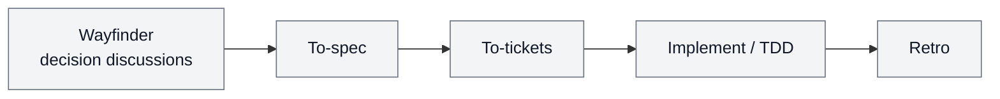
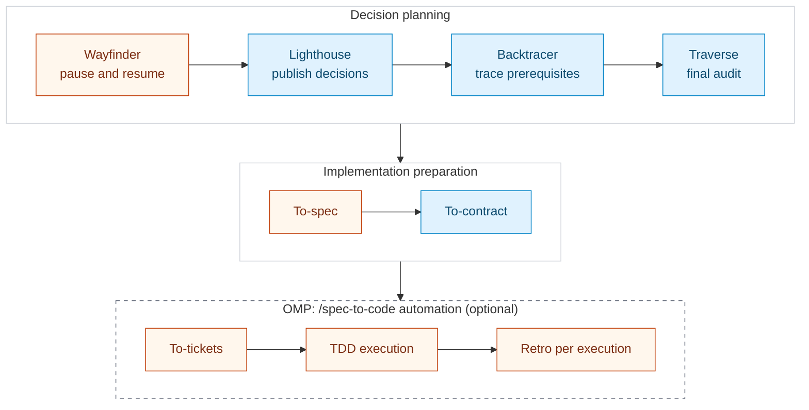

# Oh My Wayfinder

[中文文档](./README.cn.md)

**Keep decisions intact across sessions. Make requirements testable before implementation. Learn from each execution.**

Oh My Wayfinder is a non-invasive fork of [mattpocock/skills](https://github.com/mattpocock/skills) for AI-assisted engineering. It extends the upstream workflow for large efforts that need more than one conversation, and offers optional automation for [Oh My Pi](https://github.com/can1357/oh-my-pi) (OMP).

## Why this fork?

### A conversation can stop before a decision is finished

Large efforts involve research, prototypes, and decisions that depend on one another. An unfinished question should not prevent a confirmed result from being useful, and a new session should not have to reconstruct the entire discussion.

This fork adds pause and recovery to Wayfinder, publishes confirmed decisions as shared authorities, and checks their prerequisites for gaps and conflicts. A final audit checks the whole design before it becomes a specification. The goal is continuity without turning every ticket into a copy of every other ticket's policy.

### Passing tests are not enough if they lost the requirement

Requirements can disappear while work is split into tickets. Tests can also end up confirming the implementation rather than testing the behavior that was promised.

This fork separates the specification from an approved contract of promises and test seams, assigns delivery and coverage responsibilities to implementation tickets, and strengthens TDD around those responsibilities. The aim is a traceable path from an approved requirement to evidence that can detect its violation—not just a green test suite.

### Finishing implementation should not discard what it taught you

Upstream already provides Retro. The OMP extension makes it part of automated execution: each TDD execution gets a separate retrospective, with implementation and retrospective outcomes reported independently. Suggestions are recorded, not automatically applied; a completed run is not itself proof of acceptance.

## At a glance

The repository has two parts: **portable Markdown skills** for agents that support them, and an **OMP-only extension** for continuous, unattended execution. Other agents can complete the portable planning and implementation workflow by invoking skills manually; they do not need the OMP extension.

These diagrams show the large-effort route, not every upstream branch or execution rule.

### Upstream



### This fork



**Blue** marks new skills; **orange** marks changed responsibilities or integration. Lighthouse and Backtracer participate at decision-publication boundaries; Traverse audits the completed map. The diagrams omit repeated discussions, pause/resume branches, and gap follow-up. The dashed box marks what OMP automates, not a requirement to use OMP.

Skill-level automatic calls are instructions executed by the agent, not an independent scheduler. `/spec-to-code` additionally provides host-driven orchestration. It starts with a prepared spec and approved contract, automates ticket creation and serial TDD, and adds automatic Retro calls.

The Grilling overlay adds one experiment: the agent gathers common reasons into a proposed constraint, recommends its scope and tradeoffs, and waits for your authorization before using it to answer other decisions. Frontier-sized rounds and decision-tree coverage are unchanged. See the [Grilling experiment](docs/upstream-differences.md#8-grilling-experiment-reasons--proposed-constraints).

For the design changes and their mapping operations, see the [upstream comparison blueprint](docs/upstream-differences.md).

## Quick start

No agent modifications or custom installer are required for the skills: install upstream, then copy the overlay.

1. Install Matt's skills: `npx skills@latest add mattpocock/skills`.
2. Copy the contents of this repository's `skills/` into your agent's installed skill directory, preserving each skill directory. Replace files with the same name and include the new directories.
3. Run `/setup-matt-pocock-skills` in the project where you will use them. If that project already uses Matt's skills, rerun setup to review and confirm updates to its persistent configuration. Replacing installed skills does not update project configuration or migrate existing tickets automatically.
4. Not sure where to start? Invoke `/ask-matt` to choose a skill for your situation.

**Scope:** Wayfinder's extended pause/publication/backtrace loop currently targets the local Markdown tracker, not the GitHub/GitLab tracker setups.

**OMP users:** install and run the optional extension using the [spec-to-code guide](docs/spec-to-code.md). Copying skills alone does not install `/spec-to-code`.

## Further reading

| I want to… | Read |
|---|---|
| Choose the next skill | [Ask Matt](skills/ask-matt/SKILL.md) |
| Understand what this fork changes and where | [Upstream comparison blueprint](docs/upstream-differences.md) |
| Install, configure, and run OMP automation | [Spec-to-code guide](docs/spec-to-code.md) |
| Edit mappings, build skills, or update upstream | [Maintenance guide](docs/maintenance.md) |

## Maintenance commands

```bash
node deltas/build.mjs                         # Generate skills and refresh preview
node deltas/build.mjs --check                 # Check generated consistency without writing
node deltas/preview.mjs                       # Refresh preview only
node deltas/check-upstream.mjs                # Compare the snapshot with upstream HEAD
node deltas/check-upstream.mjs --verbose      # Include individual changed files
node deltas/check-upstream.mjs --local <dir>  # Compare with a local upstream checkout
```

Edit mappings rather than generated skill files. Source ownership, mapping syntax, and upstream-update procedures belong in the [maintenance guide](docs/maintenance.md).

## Acknowledgements

Built on [mattpocock/skills](https://github.com/mattpocock/skills). Thank you to Matt Pocock for the engineering workflow and MIT-licensed skills, to [skills.sh](https://skills.sh/mattpocock/skills) and the [AI Hero newsletter](https://www.aihero.dev/s/skills-newsletter), and to [Oh My Pi](https://github.com/can1357/oh-my-pi), the platform for the optional automation extension.

## License

MIT; see [LICENSE](./LICENSE). The upstream copyright notice is preserved: *Copyright (c) 2026 Matt Pocock*.
