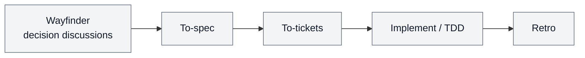
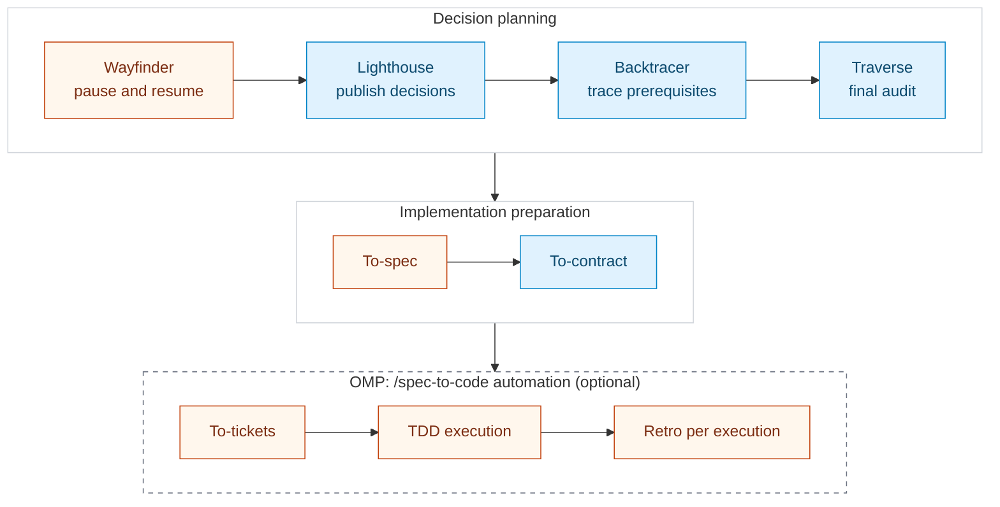

# Oh My Wayfinder

[中文文档](./README.cn.md)

When you feel like you can build anything with grill-me and are eager to take on bigger challenges with Wayfinder, have you run into any of these situations?

- **Every question has been discussed thoroughly with AI, but the pieces do not fit together.** A large requirement is split into tickets, each reasonable on its own. Yet earlier constraints get overlooked, decisions from separate discussions conflict, and the problems only surface during implementation.
- **The ticket is still unresolved, but the conversation has already entered the "dumb zone."** The scope is too large, the discussion has no end in sight, and there is no way to pause.
- **AI is ready to write code, but you still cannot clearly describe what you will get.** The plan sounds reasonable, yet the code's external behavior, whether its architecture will be easy to test, and how you will accept the result remain unclear.

Oh My Wayfinder is a set of improvements I developed to address these problems while using [Matt Pocock's Wayfinder](https://github.com/mattpocock/skills).

Wayfinder is already an excellent skill for exploring complex problems and breaking the unknown into decisions that can be resolved step by step. This fork builds on that foundation, bringing some of my development practices and ways of thinking into the workflow through three main improvements.

## Why this fork?

### Lighthouse: reconnect decisions across tickets

Matt Pocock calls the unknown that Wayfinder explores the Fog of War. Extending that metaphor, I named the skill that preserves confirmed decisions and provides a reference for further exploration Lighthouse.

While using Wayfinder for large efforts, I found that splitting a complex problem into tickets made each question easier to handle, but also weakened the connections between decisions. In some cases, implementations based on discussions spread across tickets were lower in quality than those produced from a single, continuous grilling session.

The issue is not necessarily a lack of depth in any individual ticket. Decisions that make sense locally do not always form a consistent whole.

To address this, I added Lighthouse and Backtracer:

- Lighthouse preserves confirmed conclusions, their rationale, and the conditions under which they apply. It gives different tickets a shared basis for decisions, rather than letting each maintain an understanding that gradually diverges from the others.
- Backtracer uses new conclusions to revisit earlier decisions, check their premises, and identify omissions and contradictions. The user then decides whether to supplement or revise those decisions.

This mechanism follows a habit from my own reasoning: after resolving a question, revisit earlier judgments to check whether they still hold. At decision-publication boundaries, such as ticket completion or a pause, this backward review brings new conclusions into earlier discussions, checks their consistency, and helps separate decisions converge into a coherent whole.

### Pause grilling: preserve progress and take a different path

Some topics are too large to resolve every decision in a single conversation. Staying with the same topic can prolong the discussion without bringing it closer to a conclusion.

This fork allows grilling to pause before a ticket is complete, compressing the discussion into a record sufficient to continue. That record includes not only confirmed decisions, but also their rationale, important context, and open questions. Temporary assumptions, unproductive exploration, and lengthy research do not need to be carried into the next session in full; reasons for rejecting alternatives and key evidence are retained when they still matter to future decisions.

Pausing supports more than resuming later: it also lets you change the order in which decisions are made.

If several options for the current question depend on another unresolved decision, you can save your progress, resolve that prerequisite first, and then return to the original discussion. Settling the prerequisite often narrows the options and makes the remaining decisions easier.

At a pause, confirmed results can be published through Lighthouse, with Backtracer reviewing the relevant premises. Useful conclusions can therefore support other discussions even before their source ticket is complete. When you resume, relevant new conclusions help determine the next step without starting over.

### To-contract: understand what you will get before AI writes the code

Finishing the design discussion does not necessarily mean you have a clear picture of the code that will be generated. What does it promise externally? How should it be structured for testability? How will you decide whether to accept it?

Inspired by [double-loop TDD](https://growing-object-oriented-software.com/), I split `/to-contract` out of `/to-spec` to align on three questions through three short rounds of discussion before implementation:

1. **What does it provide externally?** Clarify its behavior, interfaces, and boundaries to define the external contract for this delivery.
2. **How should it be structured to make testing straightforward?** Start by selecting test seams: architectural boundaries that make key behavior observable and relevant dependencies controllable, rather than restructuring finished code just to make it testable.
3. **How will I accept the result?** Define acceptance scenarios, pass criteria, and the evidence needed to demonstrate that the promises have been fulfilled.

Together, these questions establish the boundaries and required precision of the implementation, while helping uncover details missed in earlier decisions.

The purpose of `/to-contract` is not to rewrite the specification in another format. It is to help you build a coherent picture of the code before implementation begins: what it will provide, which key structural choices make it easy to test, and what standard it must meet to satisfy expectations.

## At a glance

The repository has two parts: **portable Markdown skills** for agents that support them, and an **OMP-only extension** for continuous, unattended execution. Other agents can complete the portable planning and implementation workflow by invoking skills manually; they do not need the OMP extension.

These diagrams show the large-effort route, not every upstream branch or execution rule.

### Upstream



### This fork



**Blue** marks new skills; **orange** marks changed responsibilities or integration. Lighthouse and Backtracer participate at decision-publication boundaries; Traverse audits the completed map. The diagrams omit repeated discussions, pause/resume branches, and gap follow-up. The dashed box marks what OMP automates, not a requirement to use OMP.

Skill-level automatic calls are instructions executed by the agent, not an independent scheduler. `/spec-to-code` additionally provides host-driven orchestration. It starts with a prepared spec and approved contract, automates ticket creation and serial TDD, and adds automatic Retro calls.

For parallel development, use the independent [`/hyper-auto-coding`](docs/hyper-auto-coding.md) command: prepare a local integration branch with committed inputs, publish and commit tickets, implement each ticket in its own worktree, release dependencies on first merge, and reuse each development worktree for asynchronous integration tests, repairs, and same-session conflict handling. Only short bidirectional merge attempts are serialized; final independent overall verification and any fixes precede report commits, without a code-review gate. Implementation concurrency defaults to 4 and shares a configuration file with Jev; the old command remains serial.

For the design changes and their mapping operations, see the [upstream comparison blueprint](docs/upstream-differences.md).

## Quick start

No agent modifications or custom installer are required for the skills: install upstream, then copy the overlay.

1. Install Matt's skills: `npx skills@latest add mattpocock/skills`.
2. Copy the contents of this repository's `skills/` into your agent's installed skill directory, preserving each skill directory. Replace files with the same name and include the new directories.
3. Run `/setup-matt-pocock-skills` in the project where you will use them. If that project already uses Matt's skills, rerun setup to review and confirm updates to its persistent configuration. Replacing installed skills does not update project configuration or migrate existing tickets automatically.
4. Not sure where to start? Invoke `/ask-matt` to choose a skill for your situation.

**Scope:** Wayfinder's extended pause/publication/backtrace loop currently targets the local Markdown tracker, not the GitHub/GitLab tracker setups.

**OMP users:** install and run the optional extension using the [spec-to-code guide](docs/spec-to-code.md). Copying skills alone does not install `/spec-to-code`.

## Further reading

| I want to… | Read |
|---|---|
| Choose the next skill | [Ask Matt](skills/ask-matt/SKILL.md) |
| Audit tests without automatically changing them (invoke `/test-audit` explicitly) | [Test Audit](skills/test-audit/SKILL.md) |
| Measure test bottlenecks and implement contract-preserving optimizations (invoke `/test-optimize` explicitly) | [Test Optimize](skills/test-optimize/SKILL.md) |
| Understand what this fork changes and where | [Upstream comparison blueprint](docs/upstream-differences.md) |
| Install, configure, and run serial OMP automation | [Spec-to-code guide](docs/spec-to-code.md) |
| Develop concurrently on a local integration branch | [Hyper-auto-coding guide](docs/hyper-auto-coding.md) |
| Edit mappings, build skills, or update upstream | [Maintenance guide](docs/maintenance.md) |

## Maintenance commands

```bash
node deltas/build.mjs                         # Generate skills and refresh preview
node deltas/build.mjs --check                 # Check generated consistency without writing
node deltas/preview.mjs                       # Refresh preview only
node deltas/check-upstream.mjs                # Compare the snapshot with upstream HEAD
node deltas/check-upstream.mjs --verbose      # Include individual changed files
node deltas/check-upstream.mjs --local <dir>  # Compare with a local upstream checkout
```

Edit mappings rather than generated skill files. Source ownership, mapping syntax, and upstream-update procedures belong in the [maintenance guide](docs/maintenance.md).

## Acknowledgements

Built on [mattpocock/skills](https://github.com/mattpocock/skills). Thank you to Matt Pocock for the engineering workflow and MIT-licensed skills, to [skills.sh](https://skills.sh/mattpocock/skills) and the [AI Hero newsletter](https://www.aihero.dev/s/skills-newsletter), and to [Oh My Pi](https://github.com/can1357/oh-my-pi), the platform for the optional automation extension.

## License

MIT; see [LICENSE](./LICENSE). The upstream copyright notice is preserved: *Copyright (c) 2026 Matt Pocock*.
